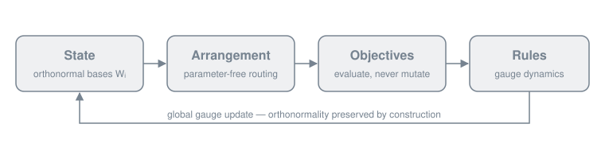

<p align="center">
  
</p>

# cosmos-rs

*Learning as gauge dynamics on the Grassmannian — a reference implementation in Rust.*

[](https://crates.io/crates/cosmos-rs)
[](https://docs.rs/cosmos-rs)
[](https://github.com/ryuuft/cosmos-rs/actions/workflows/ci.yml)
[](https://github.com/ryuuft/cosmos-rs)
[](LICENSE)
[](https://doi.org/10.5281/zenodo.23619062)

**COSMOS — Continuous Subspace Manifold Operating System** is a learning framework in
which every learnable quantity is an orthonormal subspace basis and learning is gauge
dynamics on the Grassmannian rather than Euclidean descent on weights. A parameter-free
Arrangement routes signals, Objectives evaluate configurations without mutating them, and
Rules move the State by global, coherent gauge updates that preserve orthonormality by
construction. `cosmos-rs` is the reference Rust implementation of the framework and of
every experiment reported in the
[accompanying article](https://doi.org/10.1007/s00521-026-12581-3).

<p align="center">
  
</p>

## Highlights

- **Orthonormality by construction, not by regularization.** Every state block lives on
  the Stiefel manifold and every update is an orthogonal transport; the invariant is
  measured, tested and preserved across training, not nudged by a penalty term.
- **Pure Rust by default.** The default feature set has no system dependencies; the
  optional `lapack` feature delegates the dense decompositions to a generic BLAS/LAPACK.
- **Deterministic and reproducible.** Initialization is keyed on
  `(seed, block, row, column)`, so the same seed reproduces bit-identical bases — the
  exact bases behind the article's runs.
- **Self-describing, `f64`-exact checkpoints.** A versioned container with named
  matrices and a trailing checksum round-trips the full state without loss.
- **Tested against its own contracts.** 800+ tests, including integration tests for the
  SAOR contracts, the orthogonality invariant and the checkpoint round trip.
- **Reproducible science.** The article's every table and figure maps to a config, a
  command and an output under [`docs/paper/provenance.md`](docs/paper/provenance.md).

## Status

Version 0.1.0. The library provides `state`, `geometry`, `compute`,
`arrangement`, `objectives`, `rules`, `models`, `training`, `diagnostics`,
`metrics` and `checkpoint`, plus a curated `prelude`; the flat and
patch-wise classification models with the four interior topologies; gauge
dynamics; and the checkpoint round trip. Four runnable examples cover the
library end to end, listed under [Getting started](#getting-started). The
reproduction driver for the article is described under
[Reproducing the article](#reproducing-the-article).

The public API follows Semantic Versioning from this version onward. While
the major version is zero, a minor bump may change the API; a patch bump
will not.

## Repository layout

| Path | Contents |
|---|---|
| `crates/cosmos-rs` | the published library: state, geometry, compute, arrangement, objectives, rules, models, training, diagnostics, metrics, checkpoint |
| `crates/cosmos-rs/examples` | four runnable examples, from a synthetic quickstart to bringing your own data |
| `crates/cosmos-paper` | the reproduction driver for the article's experiments (not published to crates.io) |
| `xtask` | the check runner (`cargo run -p xtask -- checks`): format, clippy, typos, dependency audit, tests, docs |
| `configs/paper` | one TOML per experiment cell; the only source of hyperparameters |
| `results/paper` | the small CSV tables that reproduce the article's tables |
| `scripts/paper` | portable launchers, resident-set pollers and the figure scripts |
| `docs/book` | the guide |
| `docs/adr` | architecture decision records |
| `docs/paper` | provenance of every published item, and the errata |

## Getting started

Add the library to a project:

```text
cargo add cosmos-rs
```

or in `Cargo.toml`:

```toml
[dependencies]
cosmos-rs = "0.1"
```

The library uses `f64` throughout. Building the paper's flat classifier and training it
takes a few lines; `batch` is any `FlatClassificationBatch` built from an
`Array2<f64>` of inputs and one label per row:

```rust
use cosmos_rs::prelude::*;
use ndarray::Array2;

let config = CosmosModelConfig::new(784, 10)
    .with_input_subspace_dim(32)
    .with_interior_subspace_dim(16)
    .with_num_interior_blocks(5)
    .with_cmr_k(8)
    .with_interior_topology(InteriorTopology::Series);
let mut model = CosmosModel::new(config)?;
model.get_state_mut().seed_orthonormal(319_635_789)?;

let mut adapter = FlatClassificationAdapter::new(Default::default())?;
let mut backend = DeviceBackend::default();
let mut rules = GaugeDynamics::new(
    model.get_state().num_blocks(),
    GaugeDynamicsConfig { lr: 0.01, momentum: 0.9, ..Default::default() },
)?;

for epoch in 1..=8 {
    model.set_epoch_batch(epoch, 0)?;
    let out = adapter.train_batch(&model, &batch, &mut backend, false)?;
    let grads: Vec<Option<Array2<f64>>> = out.gradients.iter()
        .map(|g| g.as_ref().map(|b| backend.device().download_2d(b)))
        .collect();
    let refs: Vec<Option<&Array2<f64>>> = grads.iter().map(|g| g.as_ref()).collect();
    rules.step(model.get_state_mut(), &refs)?;
}

// The invariant the whole framework is built around:
assert!(model.get_state().total_orthogonality_error() < 1e-10);
```

Runnable examples ship under `crates/cosmos-rs/examples`, each covering a
different corner of the library end to end:

```text
cargo run --release --example quickstart_synthetic
cargo run --release --example flat_classifier
cargo run --release --example patchwise_classifier
cargo run --release --example custom_data
```

## Feature flags

| Feature | Default | Effect |
|---|---|---|
| *(none)* | yes | pure Rust: one-sided Jacobi SVD and Householder QR, no system dependencies |
| `lapack` | no | delegates the dense decompositions to a generic BLAS/LAPACK via `ndarray-linalg`; the SVD driver (`gesvd` default, `gesdd` optional) is recorded per run |

## Documentation

- **[The guide](https://ryuuft.github.io/cosmos-rs/)** — concepts, a getting-started
  walkthrough, how to bring your own data, how to reproduce the article, and the
  contribution rules. It lives under [`docs/book`](docs/book); build it locally with
  `mdbook build docs/book`.
- **[API reference](https://docs.rs/cosmos-rs)** on docs.rs.
- **[`ROADMAP.md`](ROADMAP.md)** — planned extensions and their order.
- **[`CHANGELOG.md`](CHANGELOG.md)** — notable changes per version.

## Reproducing the article

The repository contains a reproduction driver, `crates/cosmos-paper`, that
runs every experiment reported in the COSMOS article from a configuration
file under `configs/paper/`. It is not published to the registry; clone the
repository to use it.

```text
cargo run -p cosmos-paper --release -- fetch fashion-mnist
cargo run -p cosmos-paper --release -- e3 --smoke
cargo run -p cosmos-paper --release -- e3
cargo run -p cosmos-paper --release -- report
```

`--smoke` runs one seed for a few epochs and checks the result against
documented expectations before a long run is started. Datasets are cached
under `data/` and verified against pinned SHA-256 digests; run artifacts go
to `runs/`. Both directories are ignored by git.

`docs/paper/provenance.md` maps every table and figure to its configuration,
its command and its output. `docs/paper/errata.md` records the differences
between the published text and this repository.

## Citation

If you use COSMOS in academic work, cite the article:

```bibtex
@article{cosmos2026,
  author  = {Batt{\'u}, Lucas},
  title   = {COSMOS: Continuous Subspace Manifold Operating System},
  journal = {Neural Computing and Applications},
  year    = {2026},
  doi     = {10.1007/s00521-026-12581-3}
}
```

Machine-readable metadata lives in [CITATION.cff](CITATION.cff).

## Contributing

Read [CONTRIBUTING.md](CONTRIBUTING.md) first. The four SAOR contracts are hard acceptance
rules: contributions that violate them are closed without further negotiation. See
[RELEASING.md](RELEASING.md) for how a version of this workspace is released.

Questions and ideas are welcome in the
[issue tracker](https://github.com/ryuuft/cosmos-rs/issues). To report a security
problem, follow [SECURITY.md](SECURITY.md) instead of opening a public issue.

## License

Licensed under the Apache License, Version 2.0. See [LICENSE](LICENSE).
